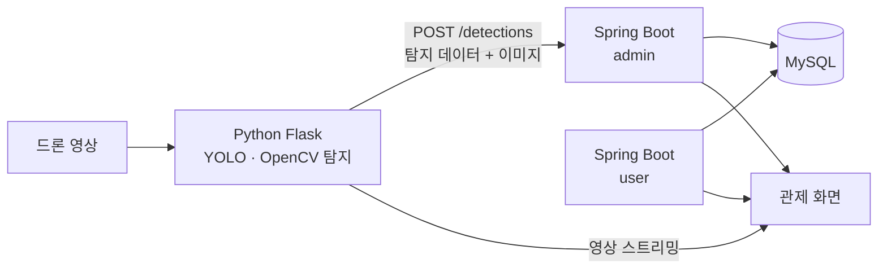

# 🔥 firezone

**드론 영상 기반 소방시설 주변 불법주정차 탐지·관제 시스템**

드론으로 촬영한 영상에서 차량과 번호판을 탐지하고, 소방시설 주변 주정차 금지구역에 서 있는 차량을 판정해 관제 화면에 실시간으로 경보를 띄우는 웹 서비스입니다.

> DW아카데미 백엔드 풀스택 웹 개발 과정 · 팀 프로젝트 (6인) · 1조 주차가 잘못됐조

<br>

## 📌 주요 기능

| 구분 | 기능 |
|---|---|
| 관제 | 드론 실시간 영상 모니터링, 최신 탐지 10건 표시(5초 갱신), 불법주정차 경보 팝업·알림음 |
| 탐지 기록 | 목록·상세 조회, 주정차 시간 계산 표시, CSV 다운로드, 기록 삭제(권한별) |
| 회원 | 회원가입 → 관리자 승인 후 이용, 로그인·로그아웃, 내 정보 수정, 탈퇴 |
| 관리자 | 회원 승인·삭제, 관리자 권한 변경 및 변경 이력 조회 |

<br>

## 🏗️ 시스템 구조



```
firezone/
├── firezonePjt_admin   # 관리자 서버 (Spring Boot)
├── firezonePjt_user    # 회원 서버 (Spring Boot)
├── firezonePjt_flask   # 관제 대시보드·탐지 화면 모듈 (Spring Boot)
└── flask               # 차량·번호판 탐지 서버 (Python Flask)
```

<br>

## 🛠️ 기술 스택

| 구분 | 기술 |
|---|---|
| Backend | Java 17, Spring Boot, Spring Security, Spring Data JPA, Gradle |
| Frontend | Thymeleaf, HTML, CSS, JavaScript |
| AI · 영상 | Python, Flask, YOLO, OpenCV |
| Database | MySQL |
| Infra | Linux(Ubuntu), Docker, Docker Compose, VirtualBox |
| 협업 | Git / GitHub, Notion, Slack |

<br>

## 👥 팀원 및 역할

| 이름 | 역할 | 담당 |
|---|---|---|
| 김리윤 | 기획 · 백엔드 | 프로젝트 총괄, REST API 수신 및 Spring Boot 연동, 서버 구축 및 연동 |
| 김태경 | 백엔드 | Flask 백엔드 개발, YOLO 모델 연동, 탐지 데이터 전송 API 구현 |
| 김현정 | DB 설계 | 요구사항 정의, 데이터베이스 설계 |
| 양현호 | 백엔드 | 관리자·회원 기능 개발, 서비스 보안 관리 |
| 우수경 | AI · 데이터 분석 | AI 모델 학습 및 개발, 탐지 데이터 분석 |
| 황유성 | 프론트엔드 | 서비스 UI 디자인, CSS 디자인 |

<br>

## 💡 고민한 부분

| 문제 | 해결 |
|---|---|
| 같은 차량이 계속 탐지되면 기록이 수십 건씩 쌓임 | 같은 날짜·구역·차량번호가 10초 안에 다시 탐지되면 기존 기록의 마지막 탐지 시간만 갱신 |
| 외부에서 탐지 저장 API를 호출할 수 있음 | 고정 IP로 운영하는 Flask 서버만 허용하도록 IP 제한 적용 |
| 주정차 시간을 DB에 저장하면 갱신할 때마다 계산이 필요함 | 최초·마지막 탐지 시간만 저장하고, 주정차 시간은 조회할 때 계산 |
| 팀원마다 개발 환경이 달라 실행이 어려움 | Docker Compose로 DB와 서버를 한 번에 실행하도록 통일 |

<br>

## ▶️ 실행 방법

Docker Desktop이 설치되어 있어야 합니다. MySQL, 관리자 서버, 회원 서버가 함께 실행됩니다.

```bash
git clone https://github.com/{아이디}/firezone.git
cd firezone
```

**개발 모드 (dev)**

```bash
docker compose -f docker-compose.dev.yml up --build
```

**운영 모드 (prod)**

```bash
docker compose -f docker-compose.prod.yml up --build -d
```

| 서비스 | dev | prod |
|---|---|---|
| 관리자 | http://localhost:8090 | http://localhost:9090 |
| 회원 | http://localhost:8091 | http://localhost:9091 |

> 탐지 서버(Python Flask)는 별도로 실행합니다. (`flask` 폴더 참고)

<br>

## 📸 화면

### 관제 화면


### 탐지 목록 · 상세


### 관리자 · 회원 승인


<br>

## 📝 아쉬운 점 · 개선 계획

- 원거리에서 바닥 글씨가 작게 찍히면 탐지가 누락됨 → 원거리 이미지 추가 수집·재학습
- 차량이 바닥 표시를 가리면 구역 판정이 어려움 → 부분 가림 데이터 보강
- 비밀번호 찾기 미구현 → 이메일 본인 확인을 통한 비밀번호 재설정 구현
